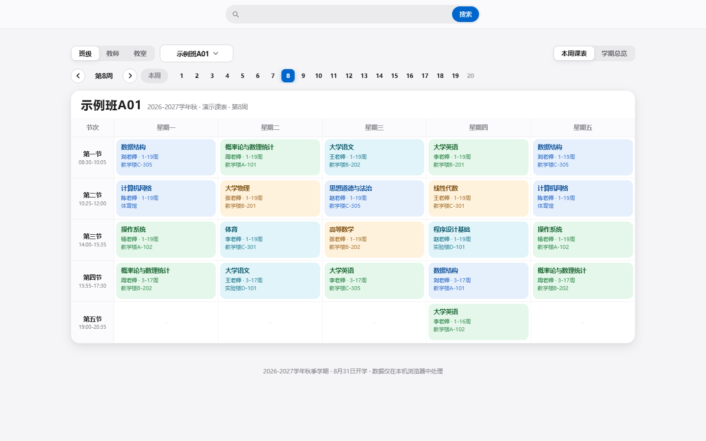
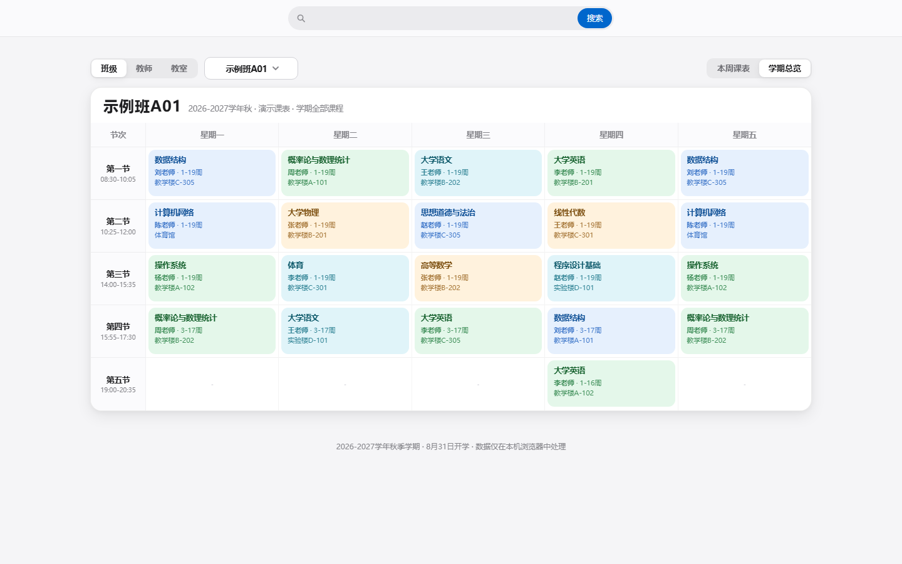
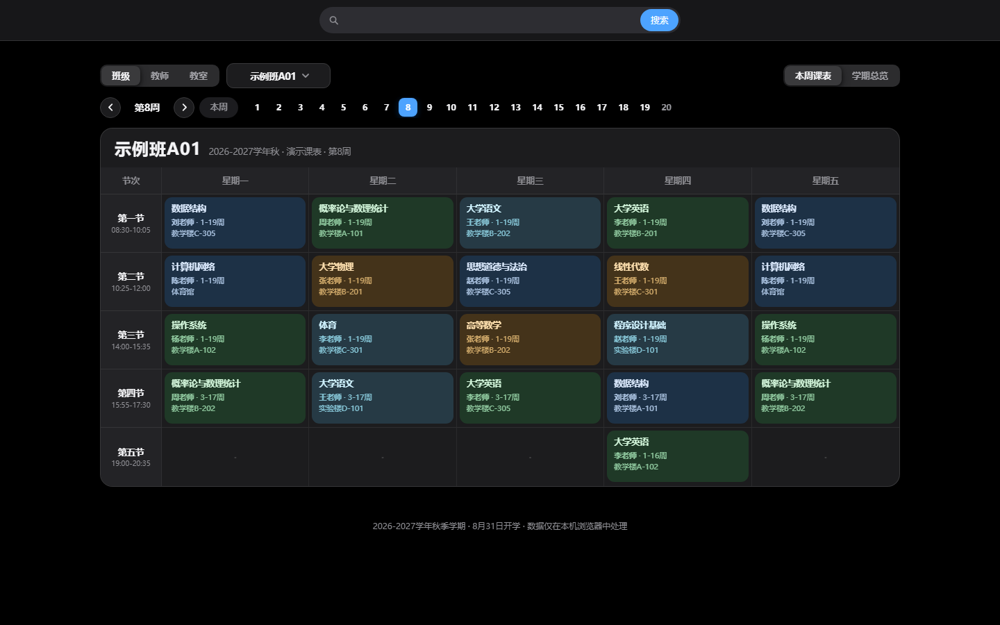
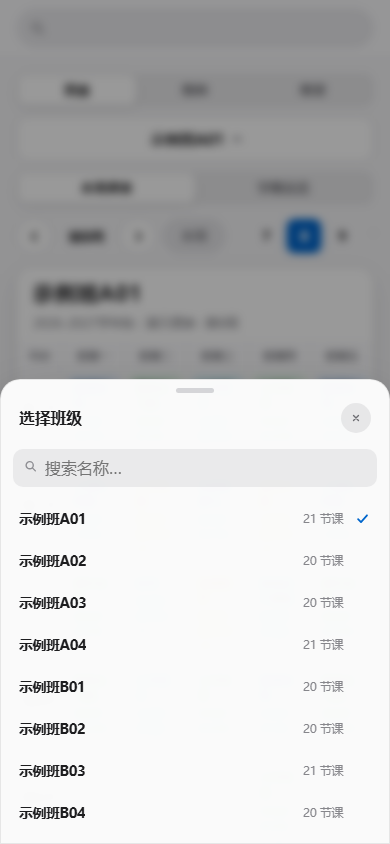

# 课表 · TimeTable

[](LICENSE)

> 2026-2027 学年秋季学期课表查询页面 —— 零依赖、零外链、单文件静态站点。

一个面向校园使用的课表浏览页面：按 **班级 / 教师 / 教室** 查看课表，支持 **本周视图 / 学期总览**、周次切换、全局搜索、课程详情与深链分享。构建产物只有一个 HTML（+ favicon），可以直接双击打开，也可以放到任意静态服务器。

**隐私说明：本仓库与公开站点只包含课程、教师、教室、周次等教务公开信息，不包含任何学生姓名或学号。** 名单相关功能同一套代码即可支持，但只有在提供（不入库的）内部数据时才会启用，详见 [数据与隐私](#数据与隐私)。



| 学期总览 | 暗色模式 | 移动端 |
|---|---|---|
|  |  |  |

> 截图由 `assets/demo/timetable.json` 的**虚构演示数据**生成（班级 / 课程 / 教师 / 教室均为示例），不含任何真实数据。执行 `npm run screenshots` 可重新生成。

---

## 功能特性

| 功能 | 说明 |
|---|---|
| 三种课表维度 | 班级 / 教师 / 教室；顶部切换 + 选择器（桌面浮层 / 移动端底部弹层，支持搜索过滤） |
| 本周课表 / 学期总览 | 按周过滤，或一次性查看整学期课程（含周次标注） |
| 周次导航 | 上一周 / 下一周 / 回到本周、20 周圆点；支持左右滑动与鼠标滚轮换周（带方向动画） |
| 全局搜索 | 课程 / 班级 / 教师 / 教室统一搜索，按位置与精确度打分排序，↑↓/Enter/Esc 全键盘可用 |
| 课程详情 | 点击课程卡片查看课程代码、教师、时间、周次、地点，并可直接跳转到对应教师/教室/班级课表 |
| 深链分享 | `#class=…`、`#teacher=…`、`#room=…`，刷新/转发可复原视图；浏览器前进后退同步 |
| 键盘无障碍 | 课程卡片可 Tab 聚焦、Enter/Space 打开详情，可见焦点环，弹窗/选择器支持 Esc 关闭 |
| 暗色模式 | 跟随系统 `prefers-color-scheme`，使用 Apple 深色设计令牌与配套课程色板 |
| 打印排版 | `@media print` 隐藏搜索/工具栏，仅输出课表网格，适合打印 |
| 离线可用 | 零外部请求（字体使用系统字体栈），断网、内网、`file://` 均可正常使用 |

## 快速开始

环境：Node.js ≥ 18（仅构建/测试需要，产物本身零依赖）。

```bash
npm test          # 产物自检（零依赖，CI 友好）
npm run build     # 构建公开版 -> dist/index.html
npm run serve     # 本地预览 http://127.0.0.1:4173
npm run screenshots  # 用演示数据重新生成 README 截图（需本机 Edge/Chrome）
```

## 部署

构建产物是一组纯静态文件（`index.html` + `favicon.svg`），不依赖任何托管平台。

### 任意静态托管

把 `dist/` 目录（`index.html` + `favicon.svg`）上传即可，无需任何后端。

### 内网服务器（含学生名单的内部版）

名单数据不入库。维护者在本地保留完整导出 `private/data.raw.json` 后：

```bash
npm run build:full     # -> dist-full/index.html（含名单，已被 .gitignore 排除）
```

把 `dist-full/index.html` 部署到内网服务器。页面逻辑会检测数据中是否存在 `people`：
存在则自动开启「本班学生名单」入口、学生搜索与名单页；公开数据没有 `people`，这些入口自动隐藏。

## 项目结构

```
.
├── src/
│   ├── index.template.html   # HTML 外壳（单文件构建的模板）
│   ├── app.js                # 全部前端逻辑（原生 JS，无框架无依赖）
│   ├── favicon.svg
│   ├── styles/
│   │   ├── base.css          # 设计令牌 + 全部组件样式
│   │   ├── extras.css        # 打印排版 + 减少动效
│   │   └── enhanced.css      # 暗色模式 + 键盘焦点环 + 系统字体栈
│   └── data/timetable.json   # 公开课表数据（无学生名单）
├── scripts/
│   ├── build.mjs             # 单文件构建（校验数据、内联 CSS/JS/数据）
│   ├── prepare-data.mjs      # 私有完整数据 -> 公开脱敏数据（白名单字段）
│   ├── check-pii.mjs         # 隐私门禁：用完整名单反查仓库文件
│   ├── screenshots.mjs       # 用演示数据重新生成截图（无头浏览器）
│   └── serve.mjs             # 零依赖预览服务器
├── tests/smoke.mjs           # 产物自检（结构/数据/无外链/DOM 锚点/体积）
├── dist/                     # 构建产物（已提交，便于直接部署/下载）
├── assets/
│   ├── demo/timetable.json   # 虚构演示数据（仅供截图）
│   └── screenshots/          # 截图（由演示数据生成，不含真实信息）
└── private/                  # 本地私有（.gitignore 排除）：完整数据、逆向材料、内部构建
```

## 数据与隐私

**会公开的**：班级名、课程名、课程代码、授课教师、教室、周次、节次时间、学期标题。

**不会公开的**：学生姓名、学号，以及任何可定位到个人的信息。具体保证：

1. `src/data/timetable.json` 由 `scripts/prepare-data.mjs` 从**字段白名单**生成，只允许 `classes/periods/title/semesterStart`；`people`（学生名单）字段会被丢弃；
2. 前端按数据自动开关名单功能：没有 `people` → 不渲染「本班学生名单」入口、不索引学生、不显示学生横幅、没有名单页；
3. `private/`（完整数据、内部构建 `dist-full/`）在 `.gitignore` 中，永不入库；`npm run build:full` 会显式警告"请勿公开"；
4. `npm run check:pii` 用完整名单（本地私有的 661 个姓名 / 662 个学号）反查仓库与产物中的每个文本文件，命中即失败；
5. 仓库截图由**虚构演示数据**生成（`assets/demo/`），不含真实课程、教师、教室或学生信息。

课表数据版权归原学校/教务部门所有，本项目仅用于查询与学习。

## 更新数据

1. 从教务系统导出完整数据，整理为如下结构（`private/data.raw.json`，不入库）：

```jsonc
{
  "title": "2026-2027学年秋  班级课表",
  "semesterStart": "2026-08-31",
  "periods": [{ "no": 1, "time": "08:30-10:05", "section": "上午" }],
  "classes": [
    { "name": "工业CA261", "title": "…", "notes": ["…"],
      "entries": [{ "course": "高等数学IA", "code": "…", "teacher": "…",
                    "weekText": "3-19周", "klass": "工业CA261(30人)", "room": "教学B楼-B-110",
                    "weeks": [3, 4, 5], "day": 1, "period": 2 }] }
  ],
  "people": [{ "name": "…", "code": "…", "klass": "…" }]   // 仅内部版使用，公开构建会剔除
}
```

2. `npm run data` 生成脱敏后的 `src/data/timetable.json`；
3. `npm run build && npm test && npm run check:pii`；
4. 如需内部版：`npm run build:full`。

## 实现说明

- **无框架、无依赖**：原生 JS（约 1.3k 行）+ 原生 CSS，构建脚本零依赖，产物零外部请求。
- **单文件构建**：`scripts/build.mjs` 把模板、三份 CSS、数据与逻辑内联成一个 HTML；数据以 `window.__TT_DATA__` 注入。
- **设计语言**：沿用 Apple Human Interface 设计令牌（颜色/间距/圆角/阴影/字重/字距），界面风格参考 [Apple Design Skill](https://github.com/chaos-xxl/apple-design-skill)（MIT）。
- **字体**：不加载任何 Web 字体，使用系统字体栈（苹方 / HarmonyOS Sans / MiSans / 微软雅黑 / 等线），保证墙内与离线可用。
- **浏览器支持**：Chrome/Edge 90+、Safari 15+、Firefox 90+（需要 CSS Grid/Custom Properties；`backdrop-filter` 不可用时自动退化为纯色）。

## 已知限制

- 学期固定为 20 周（当前数据覆盖 1–19 周），第 20 周为空周；
- 纯前端静态页面：无账号、无后端、无数据持久化，全部数据内嵌；
- 课表数据为静态快照，需按上文流程手动更新；
- 名单功能仅内部版启用（公开版无数据，不渲染入口）。

## 作者与许可

作者 / 维护者：[simplenty](https://github.com/simplenty)（仓库归属 [LouveteauSean](https://github.com/LouveteauSean) 组织）。

代码部分以 [MIT](LICENSE) 许可发布；课表数据版权归原学校/教务部门，仅作查询与学习用途。
